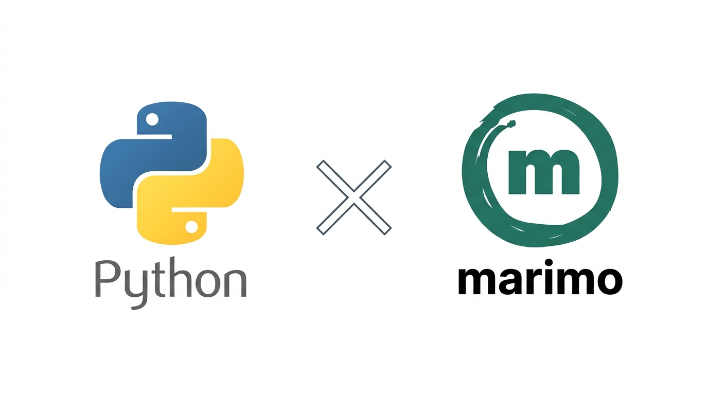

# Python Programming Language Handbook



## Summary

This repository is a self-study Python course for people who want to learn on their own. It has 15 lessons, from `print()` to data visualization. Every lesson has four lesson notebooks and four exercises.

The lessons are [marimo](https://marimo.io/) notebooks instead of plain Python files. marimo is a newer Python notebook that addresses limitations of the Jupyter Notebook. So, along with learning the Python programming language, you also learn how to get started with marimo notebooks.

## Course structure

| Lesson | Topic                                                                                        |
| ------ | -------------------------------------------------------------------------------------------- |
| 01     | [Python Basics](SYLLABUS.md#lesson-01-python-basics)                                         |
| 02     | [Conditionals and Loops](SYLLABUS.md#lesson-02-conditionals-and-loops)                       |
| 03     | [Functions](SYLLABUS.md#lesson-03-functions)                                                 |
| 04     | [Functional Tools and Generators](SYLLABUS.md#lesson-04-functional-tools-and-generators)     |
| 05     | [Strings and Lists](SYLLABUS.md#lesson-05-strings-and-lists)                                 |
| 06     | [Tuples, Sets and Dictionaries](SYLLABUS.md#lesson-06-tuples-sets-and-dictionaries)          |
| 07     | [Classes and Objects](SYLLABUS.md#lesson-07-classes-and-objects)                             |
| 08     | [OOP Principles](SYLLABUS.md#lesson-08-oop-principles)                                       |
| 09     | [Exceptions, Files and Modules](SYLLABUS.md#lesson-09-exceptions-files-and-modules)          |
| 10     | [NumPy Foundations](SYLLABUS.md#lesson-10-numpy-foundations)                                 |
| 11     | [NumPy Operations](SYLLABUS.md#lesson-11-numpy-operations)                                   |
| 12     | [Pandas Foundations](SYLLABUS.md#lesson-12-pandas-foundations)                               |
| 13     | [Pandas Data Cleaning and Analysis](SYLLABUS.md#lesson-13-pandas-data-cleaning-and-analysis) |
| 14     | [Matplotlib Visualization](SYLLABUS.md#lesson-14-matplotlib-visualization)                   |
| 15     | [Seaborn and Plotly Visualization](SYLLABUS.md#lesson-15-seaborn-and-plotly-visualization)   |

## Prerequisites

- A recent version of Python 3, from [python.org](https://www.python.org/downloads/).
- A code editor such as Visual Studio Code, or just a terminal and a web browser.

## Setup

1. Clone or download this repository.
2. Install the packages used by the notebooks:

```bash
pip install -r requirements.txt
```

3. Open any notebook in the marimo editor, for example:

```bash
marimo edit Lesson_01/01_Printing_Output.py
```

To run a notebook as a read-only app instead, use `marimo run <file>`.

## Contributing

Found a mistake or want to improve a lesson? Open an issue or a pull request.

## Acknowledgements

- The structure of this README (overview, prerequisites, repository layout, how to use the course, and a separate syllabus file) follows the example of the [ReDI School of Digital Integration introduction-to-python course](https://github.com/ReDI-Aarhus/introduction-to-python).
- The order of the lessons follows the [GeeksforGeeks Python Programming Language Tutorial](https://www.geeksforgeeks.org/python/python-programming-language-tutorial/).
